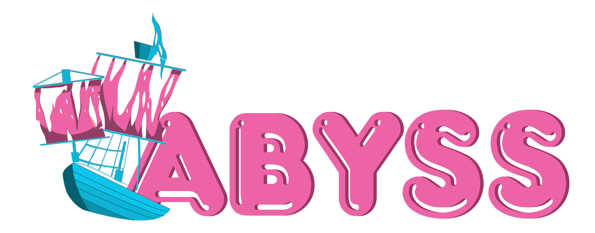

# Abyss — Agent Battle Platform



A web platform for hosting, replaying, and ranking agent-vs-agent matches.
Abyss is an **educational tool** designed to boost student motivation by letting
them pit their agents against their peers' in a live, competitive arena.

[](./LICENSE)

---

## What is Abyss?

Abyss is a full-stack web application that lets students **upload their agents**,
watch them **fight in automated matches**, and **track performance** through a
live leaderboard, fight history, and palmares.

It is built on top of [**Seahorse**](https://github.com/corail-research/seahorse) —
the Python framework used to define the games and implement the agents that
Abyss hosts.
Every match you see in Abyss is a Seahorse game running behind the
scenes; Abyss provides the arena, the ranking system, and the replay viewer,
while Seahorse provides the rules and the gameplay logic.

The platform is intentionally built for the classroom:

- **Motivation through competition** — students see their agents climb (or fall)
  in the leaderboard as they iterate, which encourages them to keep improving.
- **Peer-to-peer learning** — by fighting classmates' agents instead of only
  fixed baselines, students learn from each other's strategies.
- **Transparent evaluation** — every match is stored, replayable step-by-step,
  and exportable.

It is also designed to be:

- **Game-agnostic** — the visual game viewer and game configuration are pluggable,
  so a new Seahorse game can be swapped in for a new course offering without
  rewriting the platform.
- **Offline-friendly** — a "frozen mode" lets the whole app run against static
  JSON snapshots, so a course offering can be archived or presented without a
  live backend.

## Features

- 🔐 **Authentication** — JWT-based login with CSRF protection (students & admins)
- 🏆 **Leaderboard** — group rankings by league, with league promotion/demotion tracking
- ⚔️ **Fight system** — scheduled, in-progress, cancelled, and completed matches
- 🎞 **Replay viewer** — an embedded game viewer that replays any fight step-by-step
- 📊 **Head-to-head stats** — win rates between your agents and any opponent
- 🏅 **Palmares** — best & worst groups across configurable metrics
- 👤 **Profile page** — manage agents, banners, and personal stats
- 🛠 **Admin dashboard** — manage students, groups, agents, fights, and arena state
- 🌍 **Internationalization** — French & English out of the box (i18next)
- 📴 **Frozen mode** — run the app entirely on static JSON (no backend needed)

---

## Tech Stack

**Frontend** — React 18, Vite, Chakra UI, TanStack Query, React Router v6,
i18next, Axios (with an Orval-generated API client).

**Backend** — Python, Flask, Redis, PostgreSQL, SQLAlchemy, Docker.

**Game engine** — [Seahorse](https://github.com/corail-research/seahorse).

---

## Getting Started

### Prerequisites

- Node.js ≥ 18 and npm ≥ 9
- A running instance of the backend, **or** frozen mode enabled

### Installation

```bash
git clone https://github.com/corail-research/abyss.git
cd abyss
npm install
```

### Environement

Copy the example file and adjust it:

```bash
cp example.env .env
```

### Run locally

```bash
npm start          # dev server at http://localhost:5173
npm run build      # production build → dist/
npm run serve      # preview the production build
```

### Regenerate the API client

When the backend's OpenAPI spec changes:

```bash
npm run generate-models
```
